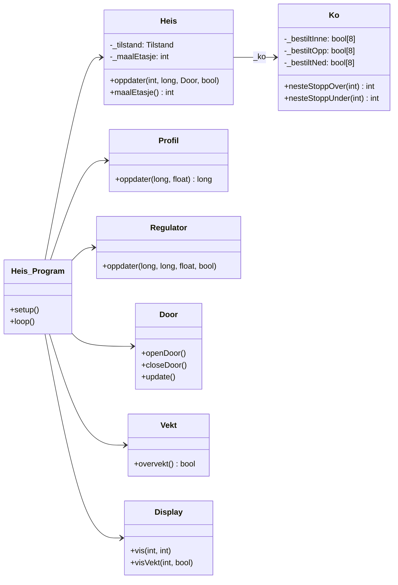
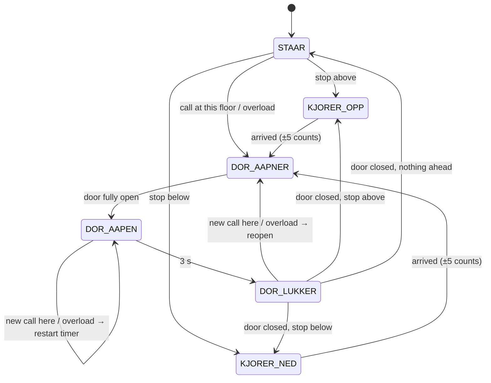
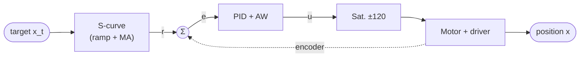

# Elevator Project – MAS246 Motion Control


A scaled eight-floor elevator controlled by an Arduino Mega 2560. The cabin
travels along a jerk-limited **S-curve**, a **plain PID controller** tracks the
reference, and a **collective queue** serves every request in the current
direction before the cabin turns around. The project is built on the open
elevator framework of Sanfilippo *et al.* [1] and the requirements document
of Hoang [2] (REQ 1–16, SAF 8).

> The elevator is a simulation: the cabin is the DC motor shaft with its
> encoder, so no real cabin mass or passenger load acts on the motor.
> 1000 encoder counts correspond to 1 m, and each floor is 4 m (4000 counts).

---

## Highlights

| | |
|---|---|
| **Motion** | Trapezoidal ramp smoothed by a 12-sample moving average → S-curve with $v_{\max}$ = 1.5 m/s, $a_{\max}$ = 2 m/s² |
| **Control** | Discrete PID ($K_p$ = 0.4, $K_i$ = 0.35, $K_d$ = 0.12), filtered D-term, anti-windup, PWM limited to ±120 |
| **Accuracy** | No overshoot, within ±5 counts about 0.5 s after the reference arrives, final error 0–3 counts |
| **Queue** | Cabin calls, hall calls up/down, serves the current direction first (REQ 16) |
| **Door** | Stepper-motor door with OPEN / HALF / CLOSED, always closed while moving (SAF 8) |
| **Safety** | Overload detection (door stays open) and an emergency mode |
| **Display** | 16×2 LCD with floor, direction arrow and load, plus one LED per queued floor |

### Measured trips

| Trip | Reference done | Settled (±5 counts) | Max \|e\| | Overshoot | Final error |
|---|---:|---:|---:|---:|---:|
| Floor 0 → 7 | 19.48 s | 20.02 s | 150 counts | 0 | 0 counts |
| Floor 0 → 2 | 6.18 s | 6.68 s | 147 counts | 0 | 3 counts |

---

## Getting started

1. Install the [Arduino IDE](https://www.arduino.cc/en/software). The only
   library used is `LiquidCrystal`, which comes with the IDE.
2. Open `Heis_Program/Heis_Program.ino`. The IDE opens all the `.cpp` and
   `.h` files in the folder as tabs.
3. Select **Tools → Board → Arduino Mega or Mega 2560** and the right port.
4. Click **Upload**. The cabin starts at floor 0 with the door closing.

The program prints data on the serial port at **115 200 baud**, which can be
used for logging and plotting.

## How to use the elevator

| Action | How |
|---|---|
| Cabin call (inside the cabin) | Press the floor button for floor 0–7 |
| Hall call (outside the cabin) | Joystick left/right selects the floor, up/down selects the direction, then press the encoder button to confirm |
| Reopen the door | Press the button for the floor the cabin is at |
| Simulate passenger load | Turn the potentiometer. At 3300 kg or more the LCD shows `OVERVEKT` and the door stays open |
| Emergency mode | Turn the encoder knob 8 steps in either direction. The cabin stops at the next floor and keeps the door open |
| Reset emergency mode | Press the encoder button twice |

A request is served when the cabin reaches the floor and the door is fully
open. The door then stays open for 3 s.

---

## How it works

### Architecture

Each class has one job. `Heis` and `Ko` decide **where to go**, while
`Profil` and `Regulator` decide **how to move**.



### Main loop

The control loop runs every **20 ms**. In each sample it reads the position,
updates the state machine, generates the reference, updates the LCD and sets
the motor output. The door stepper is updated in every pass of `loop()`,
outside the 20 ms timing, because it needs a step every 10 ms.

### State machine



The cabin can only leave a floor from `STAAR` or `DOR_LUKKER`, and only when
the door is closed, so the door is never open while the cabin moves.

### Request queue

`Ko` keeps one Boolean array per request type. The next stop above floor $k$
is the first floor with a cabin call or an up call. If there is none, it is
the highest floor with a down call, so the cabin goes to the last request
before turning around. The search below is symmetric.

### Control loop



The trapezoidal ramp is filtered by a moving average over 12 samples
(0.24 s), which turns the steps in acceleration into ramps and limits the
jerk to about 8.3 m/s³.

---

## Hardware

| Component | Function | Pins |
|---|---|---|
| DC motor + DRV8840 | Moves the cabin | DIR 6, PWM 7 |
| Quadrature encoder | Cabin position | A 21 (interrupt), B 20 |
| Stepper motor + DRV8813 | Door | 66–69 |
| MCP4922 DAC | Stepper current reference | 30–33 |
| 8 push buttons | Floor buttons in the cabin | 22–29 |
| 8 LEDs | Queued floors | 49–42 |
| Joystick X / Y | Hall call: floor / direction | A1 / A2 |
| Rotary encoder | Emergency mode | 18, 19 |
| Encoder push button | Confirm hall call, reset emergency | 2 |
| Potentiometer | Simulated passenger load | A0 |
| LCD 16×2 | Floor, arrow, load, menu | RS 41, E 40, D4–D7 37–34, BL 4 |

## Repository structure

```
Heis_Program/
├── Heis_Program.ino   main loop: timing, connects all modules, logging
├── Heis.h / .cpp      state machine (six states)
├── Ko.h / .cpp        request queue, buttons, joystick, LEDs, emergency mode
├── Profil.h / .cpp    S-curve reference (trapezoid + moving average)
├── Regulator.h / .cpp PID controller and motor output
├── Posisjon.h / .cpp  encoder reading, conversion between counts and floors
├── door.h / .cpp      stepper motor door (OPEN / HALF / CLOSED)
├── dac.h / .cpp       MCP4922 DAC for the stepper current
├── Vekt.h / .cpp      simulated load and overload check
└── Display.h / .cpp   LCD output
```

## Team

Anders Ørnevik, Torjus Tuft and Axel Leon Gunnar Wraa  
Department of Engineering Sciences, University of Agder, Grimstad

## References

1. F. Sanfilippo, M. B. Økter, T. C. Eie and M. Ottestad, "Teaching Motion
   Control in Mechatronics Education Using an Open Framework Based on the
   Elevator Model," *Machines*, vol. 10, no. 10, p. 945, 2022.
   [doi:10.3390/machines10100945](https://doi.org/10.3390/machines10100945)
2. T. S. Hoang, "An Elevator System – Requirements Document," ECS,
   University of Southampton, 2018.
